# LASU Advisor system architecture

This diagram describes the deployed browser application, role based access, Supabase data path, and transcript OCR flow. The Vercel API route is used for optional server side OCR enrichment; PDF text extraction and OCR fallback can also run in the browser.

```mermaid
flowchart LR
    subgraph People[People and entry points]
        Student[Student]
        Staff[Lecturer, HOD, Dean]
        Admin[Authenticated Admin]
        Browser[Browser: React + Vite management portal]
        Student --> Browser
        Staff --> Browser
        Admin --> Browser
    end

    subgraph Vercel[Vercel deployment]
        Static[Static frontend: dist/index.html + assets]
        SPA[React routes and dashboards]
        OCRAPI[POST /api/ocr/transcript]
        OCRSecret[Server only: GEMINI_API_KEY, when configured]
        Static --> SPA
        OCRAPI --> OCRSecret
    end

    subgraph Identity[Authentication and authorization]
        AuthUI[Login and student registration UI]
        SupaAuth[Supabase Auth: credentials and session]
        RoleGate[Role checks: student, staff, admin]
        Provision[Admin portal: staff account provisioning]
        AuthUI --> SupaAuth
        SupaAuth --> RoleGate
        RoleGate -->|student| StudentDash[Student dashboard]
        RoleGate -->|lecturer, HOD, Dean| StaffDash[Staff dashboards]
        RoleGate -->|admin| AdminDash[Management dashboard]
        AdminDash --> Provision
        Provision -->|Admin session required| SupaAuth
    end

    subgraph Supabase[Supabase backend]
        Profiles[(Profiles and role data)]
        Academic[(Courses, results, advising, messaging)]
        Storage[(result-documents storage)]
        RLS[Row Level Security policies]
        SupaAuth --> RLS
        RoleGate -->|authenticated data requests| RLS
        RLS --> Profiles
        RLS --> Academic
        RLS --> Storage
    end

    subgraph OCR[Transcript processing]
        Upload[Select transcript PDF]
        Extract[Browser PDF text extraction]
        ClientOCR[Browser OCR fallback: Tesseract]
        APIParse[Vercel OCR route: parse and enrich]
        Review[Review extracted courses and grades]
        Persist[Save verified results and file metadata]
        Upload --> Extract
        Extract -->|Readable text| APIParse
        Extract -->|Scanned or low text| ClientOCR
        ClientOCR --> APIParse
        APIParse -->|OCR unavailable or error| ClientOCR
        APIParse --> Review
        ClientOCR --> Review
        Review -->|Student confirms| Persist
        Persist -->|session scoped upload| Storage
        Persist -->|authenticated result records| RLS
    end

    Browser --> Static
    SPA --> AuthUI
    StudentDash -->|upload transcript| Upload
    StaffDash -->|authorized advising and review| Academic
    AdminDash -->|management actions| RLS
```

## Request and data flow

1. Vercel serves the Vite build from `dist`; client routes are handled by React. The `/api` path is reserved for Vercel Functions.
2. Users sign in through Supabase Auth. The app resolves the account profile and role before showing a student, staff, or administrator dashboard.
3. Dashboard data requests use the authenticated Supabase client. Row Level Security policies scope reads and writes to the signed-in identity and its role.
4. Students upload a transcript PDF. The browser extracts embedded text and can run Tesseract for scanned pages. The optional `/api/ocr/transcript` function processes the supplied content and can use the server only Gemini key when present.
5. Extracted course rows are presented for review. After confirmation, transcript files are uploaded to the `result-documents` bucket and result records are saved through the authenticated Supabase session.
6. Staff accounts are provisioned in the management dashboard. The UI requires an authenticated `admin` role; database policies also restrict staff and administrator profile writes to administrators.

## Deployment configuration

Vercel builds the frontend with `npm run build:web` and publishes `dist`. API functions are discovered from `api/`. Set `VITE_SUPABASE_URL` and `VITE_SUPABASE_ANON_KEY` in the Vercel build environment so the built browser bundle can connect to the intended Supabase project. Keep `GEMINI_API_KEY` server only.
