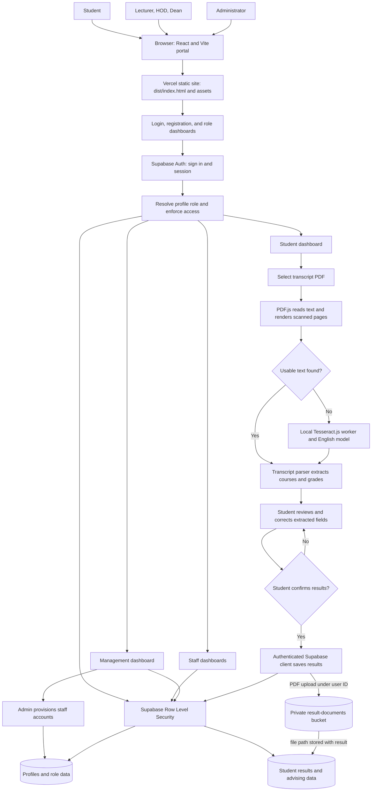

# LASU Advisor system architecture

This top-down diagram covers the full browser-to-storage path, including role checks, Supabase services, transcript recognition, review, and persistence.

## Data flow

1. Vercel serves the Vite build from `dist`. React handles client-side routes; `/api` is excluded from the SPA fallback and remains available for Vercel Functions.
2. Users authenticate through Supabase Auth. The portal resolves their role before opening the matching dashboard. Authenticated requests use the Supabase client and database Row Level Security.
3. Transcript PDFs are processed in the browser. PDF.js extracts embedded text; for image-only scans, it renders every page and Tesseract.js performs OCR locally with the bundled open-source English model and WebAssembly core. Document contents are not sent to an OCR API.
4. The parser extracts detected values without substituting fabricated course grades. Students review and correct the extracted rows before saving.
5. On confirmation, the browser uploads the PDF to the private `result-documents` bucket under the signed-in user's ID, then inserts the course rows, CGPA, file name, and storage path into `student_results` through the authenticated Supabase client. If the database insert fails, the uploaded object is removed.
6. Database and Storage policies scope access to the authenticated user and approved staff/admin roles. Staff accounts are provisioned through the authenticated Admin dashboard.

## Deployment settings

`vercel.json` sets the framework to Vite, runs `npm run build:web`, publishes `dist`, and gives the React app a client-side route fallback that excludes `/api`. `VITE_SUPABASE_URL` and `VITE_SUPABASE_ANON_KEY` must be present in the Vercel build environment; the OCR model and worker are static assets and need no API key.
